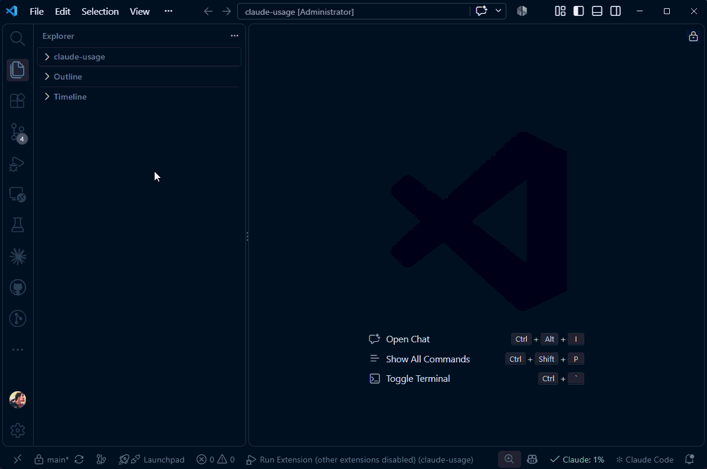
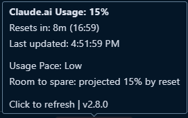
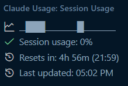
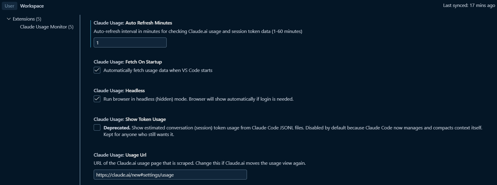

# Claude Usage Monitor

[](https://github.com/sponsors/Gronsten)

Monitor your Claude.ai usage directly in VS Code, and see at a glance whether you are outpacing the current 5-hour window. Usage is read from Claude.ai via direct API access (with automatic fallback to web scraping) using a background browser session that you sign in to once.

> [!TIP]
> **NEW in v2.7.0:** A **Usage Pace** indicator (Low / Medium / High) projects where your usage will land when the window resets, and the extension now handles Claude.ai's Cloudflare "verify you are human" check by prompting you instead of failing silently.

> [!NOTE]
> **Claude Code token tracking is deprecated** and off by default (`claudeUsage.showTokenUsage`), because Claude Code manages and compacts its own context. The code is retained; set the setting to `true` to re-enable it.

## Demo



*See the extension in action: automatic usage fetching, status bar updates, and detailed usage breakdowns*

## Screenshots

### Status Bar Integration


Dual usage display showing both Claude.ai web usage and Claude Code token consumption at a glance.

### Detailed Tooltip


Hover over the status bar for detailed usage information including reset times and your usage pace.

### Tree View Panel


Dedicated activity bar panel with 5-hour usage, reset countdown and a usage trend sparkline.

### Configuration Settings


Simple configuration options for auto-refresh intervals and behavior customization.

## Features

- **Direct API Access** 🚀: Fast, reliable data retrieval using Claude.ai's internal API
  - 2-3x faster than traditional web scraping
  - More reliable (JSON parsing vs HTML regex)
  - Intelligent fallback to HTML scraping if API fails
  - No breaking changes when Claude.ai updates their UI
- **5-Hour Usage Monitoring**: Claude.ai usage percentage with reset countdown and clock time
- **Usage Trend**: Sparkline of recent usage in the tree view
- **Status Bar Integration**: Usage at a glance (e.g., "Claude: 45%"), colored by usage pace
- **Tree View Panel**: Detailed usage information in a dedicated side panel
- **Configurable Auto-Refresh**: Customizable refresh interval (1-60 minutes, default 5 minutes)
- **Usage Pace Indicator**: Shows whether your usage is outpacing the time left in the 5-hour window
  - Projects usage at reset from how much of the window has elapsed
  - **Low** (projected under 70%): room to spare
  - **Medium** (70-100%): on track to use most of it
  - **High** (over 100%): you will likely hit the limit before reset; the tooltip shows roughly how long you have
  - Shows "too early to project" during the first 15 minutes of a window
- **Auto-Start**: Fetches usage data automatically when VS Code starts
- **Silent Mode**: Runs browser in headless (hidden) mode, shows window only if login or verification is needed
- **Cloudflare Verification Handling**: If Claude.ai shows a "verify you are human" check, the extension opens the browser, notifies you, waits for you to complete it, then returns to headless mode
- **Session Persistence**: Log in once, stay authenticated across VS Code sessions

## Installation

### Prerequisites

- VS Code 1.80.0 or higher
- Node.js installed (for Puppeteer/Chromium)

### Install from VSIX

1. Download the `.vsix` file
2. Open VS Code
3. Go to Extensions view (`Ctrl+Shift+X`)
4. Click the `...` menu at the top
5. Select "Install from VSIX..."
6. Choose the downloaded file

## First-Time Setup

The extension will **automatically fetch usage data** when VS Code starts. If you haven't logged in before:

1. A browser window will appear (the extension detected you need to log in)
2. Log in to Claude.ai with your credentials (Google, email, etc.)
3. Once logged in, the extension automatically fetches your usage data
4. Your session is saved locally - you won't need to log in again!
5. Future fetches run **silently in the background** (no browser window)

**That's it!** The extension will now:
- Fetch usage automatically on startup
- Refresh at your configured interval (default: every 5 minutes, range: 1-60 minutes)
- Display your Claude.ai usage and usage pace
- Run completely hidden unless login or verification is required

## Usage

### Fetch Usage Data

There are several ways to fetch your usage data:

1. **Click the status bar item** (right side of VS Code)
2. **Use Command Palette** (`Ctrl+Shift+P` / `Cmd+Shift+P`):
   - Search for "Fetch Claude Usage Now"
3. **View the Activity Bar panel**:
   - Click the Claude Usage icon in the Activity Bar (left sidebar)
   - View detailed usage information

### View Usage Information

- **Status Bar**: Shows current usage percentage with an icon colored by usage pace
  - Green check: Low pace
  - Orange warning: Medium pace
  - Red error: High pace
  - **Hover tooltip** shows:
    - Usage percentage
    - Reset time
    - Last update timestamp
    - Usage pace (Low/Medium/High) with projected usage at reset

- **Tree View Panel**: Shows detailed information:
  - Usage percentage
  - Time until reset
  - Last update timestamp

## Configuration

Open VS Code Settings and search for "Claude Usage" to configure:

### `claudeUsage.fetchOnStartup`
- **Type**: Boolean
- **Default**: `true` ✅
- **Description**: Automatically fetch usage data when VS Code starts

### `claudeUsage.headless`
- **Type**: Boolean
- **Default**: `true` ✅
- **Description**: Run browser in headless (hidden) mode. Browser will show automatically if login or human verification is needed.

### `claudeUsage.usageUrl`
- **Type**: String
- **Default**: `https://claude.ai/new#settings/usage`
- **Description**: URL of the Claude.ai usage page that is scraped. Change this if Claude.ai moves the usage view again.

### `claudeUsage.showTokenUsage`
- **Type**: Boolean
- **Default**: `false`
- **Description**: Deprecated. Show Claude Code conversation token usage in the status bar and tree view.

### `claudeUsage.autoRefreshMinutes`
- **Type**: Number
- **Default**: `5`
- **Range**: `1-60` minutes
- **Description**: Auto-refresh interval in minutes for checking Claude.ai usage and session token data

**Recommended Configuration** (`settings.json`):
```json
{
  "claudeUsage.fetchOnStartup": true,
  "claudeUsage.headless": true,
  "claudeUsage.autoRefreshMinutes": 5
}
```

**Example: Custom Refresh Interval** (`settings.json`):
```json
{
  "claudeUsage.fetchOnStartup": true,
  "claudeUsage.headless": true,
  "claudeUsage.autoRefreshMinutes": 15
}
```

## Commands

All commands are available via the Command Palette (`Ctrl+Shift+P` / `Cmd+Shift+P`):

- **`Claude: Fetch Claude Usage Now`** - Manually fetch current usage data
- **`Claude: Open Claude Settings Page`** - Open claude.ai/settings in your default browser

## How It Works

### Automatic Refresh
The extension automatically refreshes usage data at configurable intervals:
- Default: Every 5 minutes
- Customizable: 1-60 minute range
- Runs silently in the background

### Headless Browser Operation
1. The extension uses Puppeteer to launch a Chromium browser
2. On first run, it detects you need to log in (no session cookies found)
3. Browser launches in **visible mode** so you can log in manually
4. Your session is saved to `~/.claude-browser-session/` for future use
5. Subsequent fetches launch browser in **headless mode** (completely hidden)
6. The extension loads the usage view (`https://claude.ai/new#settings/usage`)
7. Usage data is read via Claude.ai's API (or extracted from the page) and displayed in VS Code
8. If Claude.ai shows a Cloudflare verification, the browser is shown so you can complete it, then hidden again

### Session Persistence
- Session cookies are stored locally by Chromium
- No credentials are stored by the extension
- Sessions typically last several weeks before expiring
- If session expires, browser will show again for re-login

## Privacy & Security

- **No credentials stored**: The extension never stores or transmits your credentials
- **Local session only**: Your authentication session is saved locally by Chromium
- **No data transmission**: Usage data stays on your machine
- **Open source**: All code is available for review

## Troubleshooting

### Browser won't launch

**Problem**: Error message "Failed to launch browser"

**Solutions**:
- Ensure you have enough disk space (~500MB for Chromium)
- Check that no antivirus is blocking Puppeteer
- Try running VS Code as administrator (Windows)

### Human verification prompt

**Problem**: A notification says "Claude.ai needs a quick human verification"

**Solutions**:
- Complete the check in the browser window that opened; the extension continues automatically
- It can reappear after a network change or when clearance cookies expire
- If headless mode keeps getting challenged, set `claudeUsage.headless` to `false`

### Login timeout

**Problem**: "Login timeout" error after 5 minutes

**Solutions**:
- Complete the login process more quickly
- Check your internet connection
- Try again - the browser window should still be open

### Session expired

**Problem**: Browser keeps asking you to log in

**Solutions**:
- Delete the session folder: `~/.claude-browser-session/`
- Log in again - session should persist this time
- Make sure `headless` mode is `false` during login

### Can't find usage data

**Problem**: "Could not find usage percentage" error

**Solutions**:
- Claude.ai may have changed their settings page layout
- Check that the usage view still loads at `https://claude.ai/new#settings/usage` (override with `claudeUsage.usageUrl` if it moved)
- Report an issue for the extension to be updated

### Performance issues

**Problem**: Browser uses too much memory

**Solutions**:
- `headless` mode is enabled by default - browser runs hidden
- The browser closes automatically after fetching to save memory
- Increase `autoRefreshMinutes` to reduce refresh frequency (e.g., 15, 30, or 60 minutes)

## Known Limitations

- Requires Chromium to be downloaded by Puppeteer (~150-200MB)
- Fetch time: 2-10 seconds depending on network speed
- If Claude.ai changes their settings page, the extension may need updates
- Sessions can expire (typically after several weeks of inactivity)

## Development

### Building from Source

The extension uses esbuild for bundling, which significantly reduces the package size by bundling all dependencies into a single file.

```bash
# Install dependencies
npm install

# Build for development (with sourcemaps)
npm run build

# Build for production (minified, no sourcemaps)
node esbuild.js --production

# Watch mode for development
npm run watch

# Package extension
npm run package
```

### Project Structure

- `extension.js` - Main extension entry point
- `src/` - Source modules (bundled into dist/)
  - `dataProvider.js` - Tree view data provider
  - `statusBar.js` - Status bar integration
  - `activityMonitor.js` - Usage pace calculation (Low/Medium/High)
  - `sessionTracker.js` - Claude Code session management
  - `claudeDataLoader.js` - JSONL file parser
  - `scraper.js` - Claude.ai web scraper
  - `usageHistory.js` - Historical usage data storage
  - `utils.js` - Utility functions
- `dist/` - Built output (generated by esbuild)

## Feedback & Issues

If you encounter any issues or have suggestions:

1. Check the troubleshooting section above
2. Review open issues on the project repository
3. Submit a new issue with:
   - VS Code version
   - Extension version
   - Error messages from the Output panel (View → Output → Claude Usage Monitor)
   - Steps to reproduce

## Version History

See [CHANGELOG.md](CHANGELOG.md) for version history and updates.

## License

MIT License - See LICENSE file for details

---

**Note**: This is an unofficial extension and is not affiliated with Anthropic or Claude.ai.
